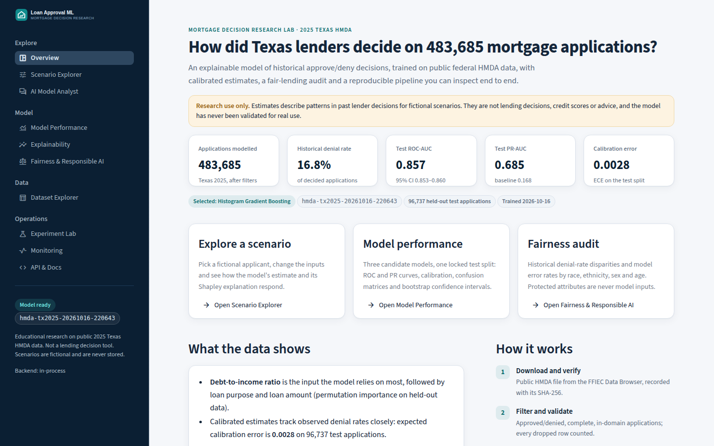
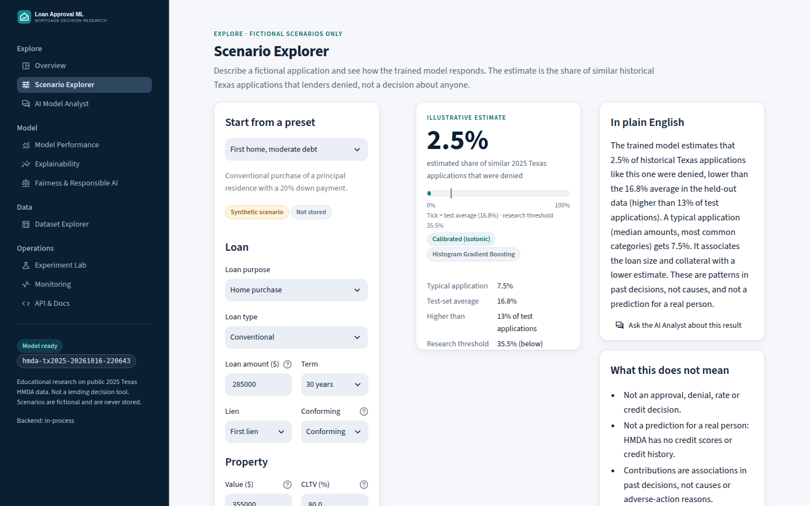
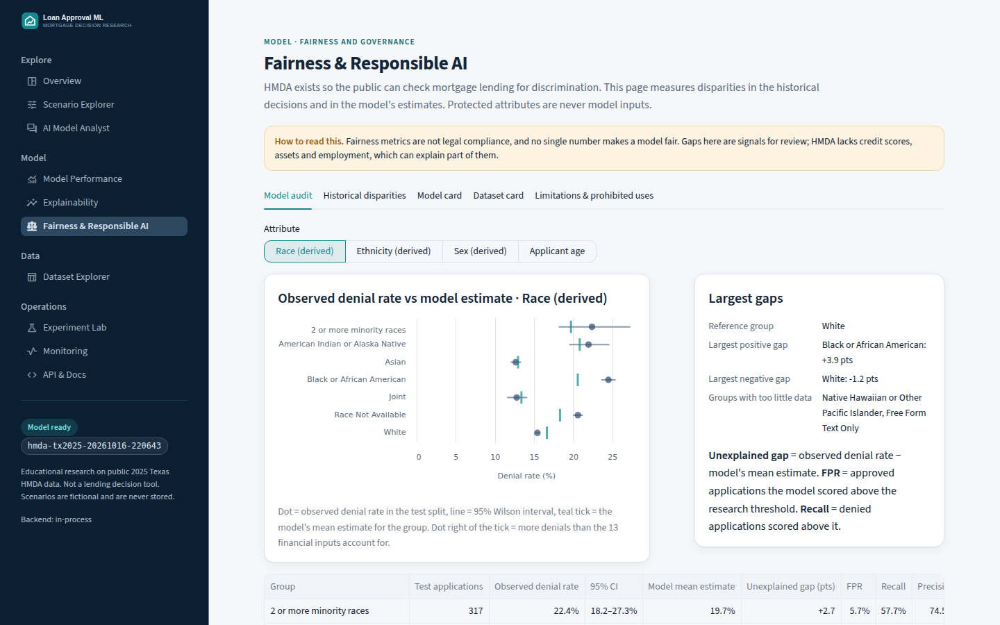

# Loan Approval ML

**An explainable mortgage-decision research lab trained on 483,685 real 2025 Texas HMDA applications,
with calibrated estimates, a fair-lending audit, a FastAPI service and a Streamlit dashboard.**

[](https://github.com/saalderete/Loan-Approval-ML/actions/workflows/ci.yml)


> **Research and education only.** This project models *historical* lender decisions from public
> data. It is not an underwriting system, it does not make or recommend credit decisions, and it only
> accepts fictional scenarios. See [Limitations](#limitations-and-responsible-use).



## What it does

The Home Mortgage Disclosure Act requires U.S. lenders to report every mortgage application and its
outcome. This project uses the 2025 Texas file to answer two questions:

1. **How did lenders decide?** A calibrated model estimates the share of applications like a given
   fictional one that were *denied*, and explains which inputs moved that estimate.
2. **Were outcomes different across groups?** A fair-lending audit compares denial rates, and the
   model's estimates and errors, by race, ethnicity, sex and age. Those attributes are never model inputs.

## Results (held-out test split, 96,737 applications)

| Model | ROC-AUC (95% CI) | PR-AUC (95% CI) | Brier | ECE |
|---|---|---|---|---|
| **Histogram Gradient Boosting** (selected) | **0.857** (0.853–0.860) | **0.685** (0.679–0.691) | 0.0850 | 0.0028 |
| Random Forest | 0.848 (0.844–0.851) | 0.659 (0.653–0.666) | 0.0890 | 0.0035 |
| Logistic Regression (baseline) | 0.820 (0.816–0.824) | 0.589 (0.582–0.596) | 0.0981 | 0.0036 |
| Prevalence-only baseline | 0.500 | 0.168 | 0.1398 | – |

- Denial rate in the modelled data: **16.8%**. PR-AUC is the pre-registered selection metric because
  denials are the minority class.
- The model was chosen on a separate *selection* split before the test split was scored once.
  Confidence intervals come from 200 bootstrap resamples.
- **Most important inputs:** debt-to-income ratio, loan purpose, loan amount, property value and
  combined LTV (permutation importance).
- **Fair-lending signal:** Black applicants in the test split were denied **24.5%** of the time, versus
  **20.6%** expected from the 13 financial inputs, a **3.9-point gap** the inputs don't account for.
  HMDA has no credit scores, so this is a signal for review, not proof of discrimination.

Every number above comes from [`models/hmda-tx2025-*/model_card.md`](models/), which is generated
automatically from the saved evaluation files.

## Features

| | |
|---|---|
| **Leakage-safe data pipeline** | Downloads the public file with a SHA-256 checksum, documents every filter, and excludes post-decision fields (interest rate, denial reasons), process artifacts, protected attributes and geographic proxies. Training uses only complete applications, because missingness itself leaks the decision. |
| **Rigorous evaluation** | Stratified train/calibration/selection/test split fixed up front (hash recorded), CV tuning on train only, isotonic calibration on its own split, ROC/PR/calibration curves, bootstrap CIs and a leakage screen. |
| **Explainability** | Global permutation importance, logistic coefficients, and **exact Shapley values over grouped inputs** for each scenario. Grouping keeps the explanation from asking the model about impossible applications. |
| **Fair-lending audit** | Historical denial-rate disparities with Wilson intervals, plus model FPR, recall and an "unexplained gap" per group. Small groups are suppressed rather than shown as misleading rates. |
| **Model registry and MLOps** | Versioned, checksummed artifacts, 10 automated promotion gates, an explicit and audited promotion step, out-of-process training jobs, and input-drift monitoring (PSI). |
| **FastAPI service** | Typed `/api/v1` contract, strict input validation, rate limits, body-size limits, security headers, and an admin token for training and promotion. |
| **Premium dashboard** | 10-page Streamlit app with light and dark themes: Scenario Explorer, Model Performance, Explainability, Fairness & Responsible AI, Dataset Explorer, Experiment Lab, Monitoring, AI Analyst and API docs. |
| **AI Model Analyst** | Optional LLM assistant that can only call read-only evidence tools. It must cite evidence, its numbers are checked against that evidence, and requests for real credit decisions are refused before any LLM call. Deterministic answers work without an API key. |

| Scenario Explorer | Fairness audit |
|---|---|
|  |  |

## Quick start

```bash
git clone https://github.com/saalderete/Loan-Approval-ML.git
cd Loan-Approval-ML
python3 -m venv .venv && source .venv/bin/activate     # Python 3.11+
pip install -r requirements.txt && pip install -e .

streamlit run app/streamlit_app.py                     # dashboard at http://localhost:8501
uvicorn loan_approval.api.app:app --port 8000          # API at http://localhost:8000/docs
```

The trained model is committed under `models/`, so both commands work without downloading any data.

**Docker** (API plus a dashboard that calls it):

```bash
docker compose up --build
```

### Reproduce the model from public data

```bash
loan-approval fetch        # ~284 MB from the FFIEC Data Browser; checksum recorded in data/data_manifest.yaml
loan-approval prepare      # validate, filter, report the funnel
loan-approval train        # tune, calibrate, select, test once, audit, register (~2 min on 4 CPUs)
loan-approval list
loan-approval promote <version> --actor "Your Name" --reason "Reviewed gates and model card"
```

### Score a scenario

```bash
loan-approval predict --scenario high-dti-cashout

curl -s -X POST localhost:8000/api/v1/predict -H 'Content-Type: application/json' -d '{
  "scenario": {"loan_amount": 285000, "property_value": 355000, "income": 112,
               "debt_to_income_ratio": "30%-<36%", "combined_loan_to_value_ratio": 80,
               "loan_term": 360, "loan_type": "1", "loan_purpose": "1", "lien_status": "1",
               "occupancy_type": "1", "total_units": "1"}}'
```

## Architecture

```text
FFIEC HMDA Data Browser
   │  fetch (SHA-256 → data/data_manifest.yaml)
   ▼
validate + filter ──► quality report (funnel, missingness, out-of-domain, duplicates)
   ▼
stratified split (train 60 / calibration 10 / selection 10 / test 20, hash recorded)
   ▼
CV tuning → fit  [Logistic Regression · Random Forest · HistGradientBoosting]
   ▼
isotonic calibration → select on selection split → score test split once
   ▼
fairness audit · permutation importance · drift baseline · dataset profile · model card
   ▼
registry (manifest + SHA-256 + promotion gates) ──► FastAPI /api/v1 ──► Streamlit dashboard
                                                   │                      │
                                                   └── SQLite: ops + drift counts (no inputs stored)
                                                   └── AI analyst (read-only evidence tools)
```

```text
src/loan_approval/
  data/         hmda codes, ingest, validate, split, synthetic generator
  features/     stateless feature builder, sklearn pipelines, input schema (Pydantic)
  training/     training protocol, isotonic calibration
  evaluation/   metrics, fairness, drift, dataset profile, model card
  inference/    prediction service, Shapley explanations, sensitivity
  registry/     versioned artifacts, integrity checks, promotion lifecycle
  api/          FastAPI app, security middleware, training jobs
  ai/           analyst loop, read-only tools, guardrails, provider adapter
app/            Streamlit dashboard (views/, components/)
configs/        training protocol, fictional demo scenarios
models/         registry.json + committed model version (manifest, pipelines, reports, model card)
reports/        dataset card
docs/           architecture, limitations, data governance, runbook, roadmap, current state
tests/          unit, integration, API, Streamlit UI, opt-in browser tests
```

More detail: [docs/ARCHITECTURE.md](docs/ARCHITECTURE.md) · [docs/RUNBOOK.md](docs/RUNBOOK.md) ·
[docs/CURRENT_STATE.md](docs/CURRENT_STATE.md)

## Testing and CI

```bash
pip install -r requirements-dev.txt
pytest -m "not e2e"            # 95 tests: unit, integration, API, Streamlit pages
ruff check src app tests && ruff format --check src app tests
E2E_BASE_URL=http://localhost:8501 pytest -m e2e    # optional browser test (Playwright)
```

Tests train a small synthetic model in a temp directory, so CI never needs the HMDA download.
GitHub Actions runs lint, tests on Python 3.11 and 3.12, `pip-audit`, and a Docker build with an API
smoke test.

## Optional: AI Model Analyst

Set `ANTHROPIC_API_KEY` (server-side only) to enable the chat analyst. It defaults to
`claude-opus-5-5`; override with `LLM_MODEL`. Daily request caps, rate limits, timeouts and audit
logging are built in. Without a key, the dashboard offers deterministic evidence-based answers.

## Limitations and responsible use

- **No underwriting data.** HMDA has no credit scores, credit history, assets or employment.
- **Historical decisions, not risk.** The label is denial vs. approval, not default.
- **Bias can be learned.** Patterns in past decisions, including unfair ones, can be reproduced.
- **Narrow scope.** Texas 2025, complete applications, site-built 1–4 unit homes.
- **Explanations are not causes** and are not adverse-action reasons.
- **Prohibited:** approving, denying, pricing or pre-screening real applications; marketing or
  targeting; use with real personal data.

See [docs/MODEL_LIMITATIONS.md](docs/MODEL_LIMITATIONS.md),
[docs/DATA_GOVERNANCE.md](docs/DATA_GOVERNANCE.md) and the
[dataset card](reports/dataset_card.md).

## Data source

FFIEC / CFPB, *HMDA Loan/Application Register (modified LAR), 2025, Texas, actions 1–3*, retrieved
2026-10-16 from the [HMDA Data Browser](https://ffiec.cfpb.gov/data-browser/). The raw file is not
committed; `loan-approval fetch` downloads it and verifies the checksum.

## Author

**Samuel Alderete** · [@saalderete](https://github.com/saalderete)

Released under the [MIT License](LICENSE).
